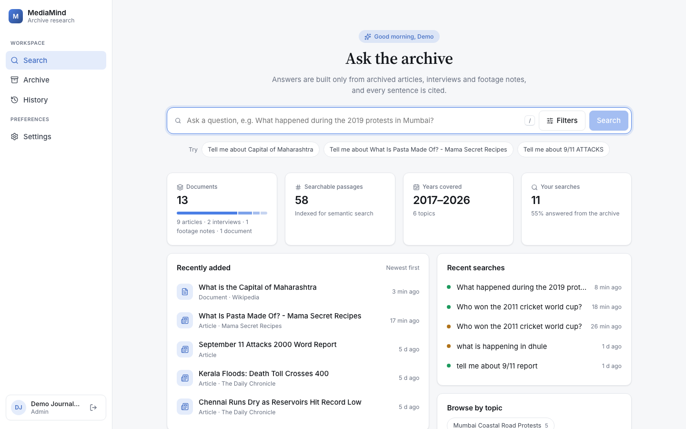
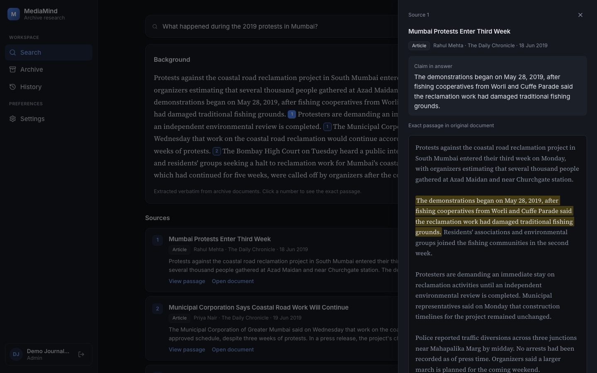
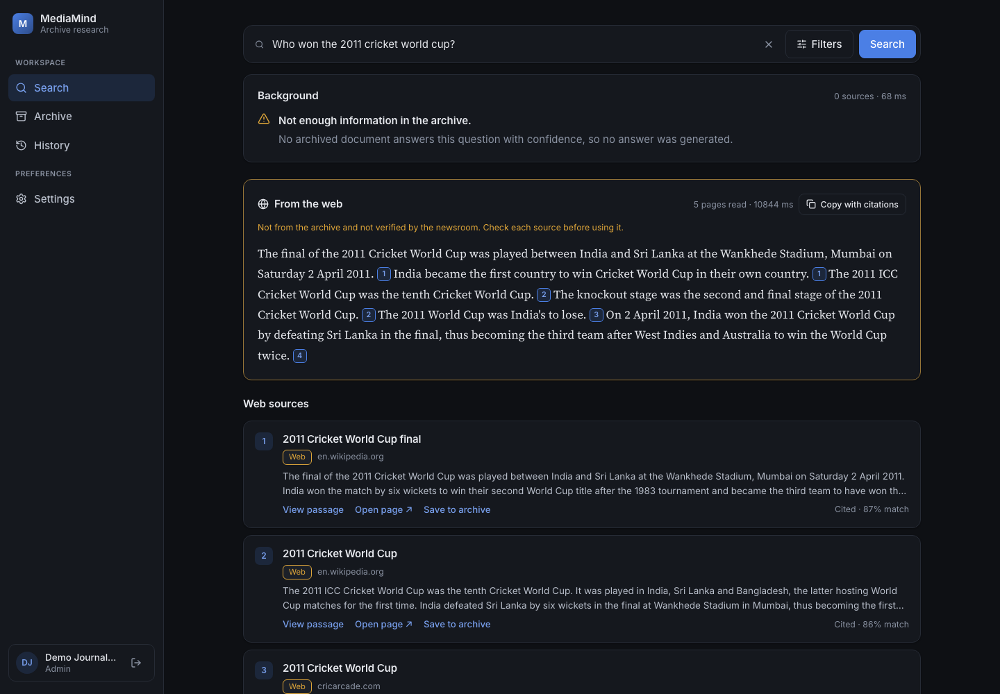
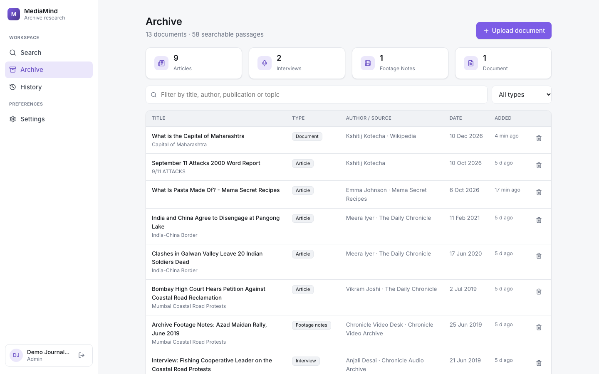
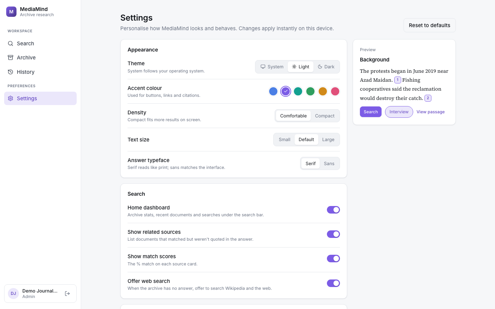
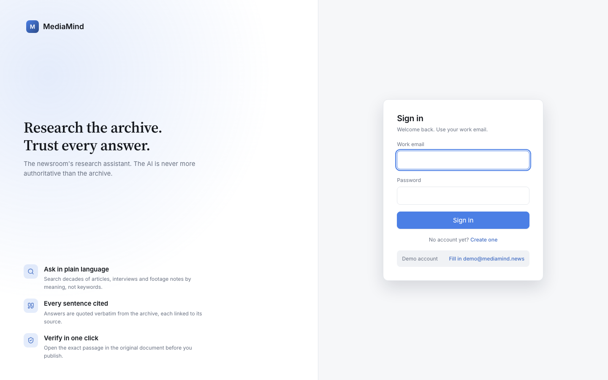
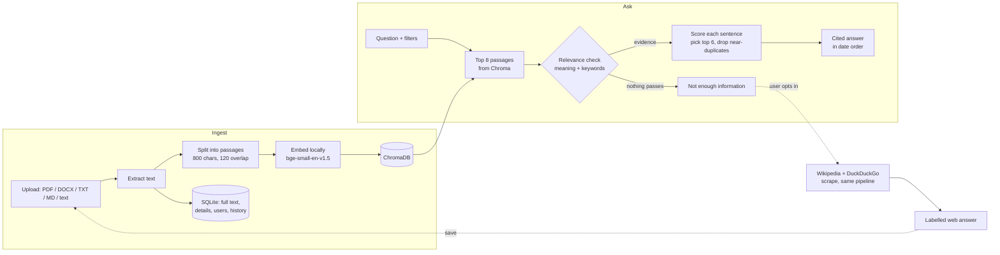

<div align="center">

# MediaMind

### Archive research for the newsroom: ask in plain English, get cited answers, verify every sentence.




</div>

---

A media company has decades of articles, interview transcripts and footage notes. MediaMind lets journalists **search that archive in natural language** and get a short background answer where **every sentence is copied word for word from an archived document and linked to its exact source passage**.

> **Key principle:** the AI should never be more authoritative than the archive.
> MediaMind doesn't generate text. It finds, ranks and quotes, so it can't state anything the sources don't say. When the archive has no answer, it says so.

Full requirements: [media_archive_research_assistant_prd.md](media_archive_research_assistant_prd.md)

## Contents

- [Features](#features)
- [Screenshots](#screenshots)
- [Quick start](#quick-start)
- [How it works](#how-it-works)
- [Project structure](#project-structure)
- [API reference](#api-reference)
- [Configuration](#configuration)
- [Troubleshooting](#troubleshooting)
- [Known limitations and roadmap](#known-limitations-and-roadmap)

## Features

**Research**
- **Natural-language search.** Semantic retrieval over the archive. Ask *"What happened during the 2019 protests in Mumbai?"* and get relevant results even when the exact words don't match.
- **Cited background answers.** Up to 6 of the most relevant sentences, in chronological order, each tagged with its source number.
- **One-click verification.** Click a citation to see the exact passage highlighted in context, then open the full original document.
- **Honest "not found."** A relevance check combining meaning and keyword overlap means unrelated documents are never stretched into an answer.
- **Filters.** Year range, content type, author, publication and topic.
- **Copy with citations.** Copies the answer with `[n]` markers and a numbered source list, ready to paste into a draft.

**Beyond the archive (opt-in)**
- **Web fallback.** When the archive has no answer, a button searches Wikipedia and the web. Results use the same quote-and-cite method but appear in a separate section **clearly labelled as unverified**. Pages that block crawlers in `robots.txt` are skipped.
- **Save to archive.** Any web source can be added to the archive through an editable form, prefilled with the title, author, date, publication, URL and full text.

**Archive management**
- **Upload** PDF, DOCX, TXT or MD files, or paste text, with title, date, author, publication, type, topic and URL.
- **Archive view** with per-type counts, search and delete.
- **Search history,** grouped by day, with answered and not-found status and one-click re-run.

**Interface**
- **Search home dashboard:** archive stats, recently added documents, recent searches, browse by topic, and suggestions based on the newest uploads.
- **Settings:** light, dark or system theme, 6 accent colours, density, text size, serif or sans answers, and search preferences.
- **Responsive layout** with a sidebar on desktop and a top bar on mobile. Press `/` to jump to the search box.
- **Login and accounts** with hashed passwords and JWT sessions.

## Screenshots

| Cited answer and passage verification | Opt-in web fallback |
|---|---|
|  |  |
| **Archive** | **Settings** |
|  |  |

<details>
<summary>Login screen</summary>

</details>

## Quick start

### Prerequisites

| Tool | Version | Check with |
|---|---|---|
| Python | **3.10 or newer** | `python3 --version` |
| Node.js | **20.19+ or 22.12+** (required by Vite 8) | `node -v` |
| Git | any | `git --version` |

You need an internet connection on the first run, which downloads a ~65 MB embedding model, and for the optional web search. **No API keys or paid services are needed.** Everything else runs locally.

### 1. Clone

```bash
git clone https://github.com/kshitij162005/Arya_MediaMind_Kalvium-Community.git
cd Arya_MediaMind_Kalvium-Community
```

### 2. Backend (terminal 1)

**macOS / Linux**

```bash
cd backend
python3 -m venv .venv                 # create an isolated Python environment
source .venv/bin/activate             # activate it (your prompt shows "(.venv)")
pip install -r requirements.txt       # install dependencies (takes a few minutes)
python seed.py                        # demo account + 10 sample documents
uvicorn app.main:app --reload --port 8000
```

**Windows (PowerShell)**

```powershell
cd backend
py -m venv .venv
.venv\Scripts\Activate.ps1
pip install -r requirements.txt
python seed.py
uvicorn app.main:app --reload --port 8000
```

When you see `Application startup complete`, the API is running at **http://localhost:8000**. Interactive API docs are at **http://localhost:8000/docs**.

> The first `seed.py` run downloads the embedding model into `backend/data/models/`. After that, everything works offline except web search.

### 3. Frontend (terminal 2)

```bash
cd frontend
npm install
npm run dev
```

### 4. Open the app

Go to **http://localhost:5173** and sign in with:

```
Email:     demo@mediamind.news
Password:  demo1234
```

Or click **"Fill in demo account"** on the login screen, or create a new account.

### 5. Try it

| Try this | What you'll see |
|---|---|
| *What happened during the 2019 protests in Mumbai?* | A cited answer built from 3 sources. Click a number to see the exact passage. |
| *What did the fishing cooperative leader say about the coastal road?* with the **Interview** filter | Only the interview transcript is quoted. |
| *How did the India-China border tensions develop?* | Events from 2017 to 2021 in chronological order. |
| *Who won the 2011 cricket world cup?* | "Not enough information in the archive". Then click **Search the web instead**, and **Save to archive** on a source. |
| **Settings** → Light theme, Violet accent | The whole UI updates instantly. |

### Next time

You only need the run commands:

```bash
# terminal 1
cd backend && source .venv/bin/activate && uvicorn app.main:app --reload --port 8000
# terminal 2
cd frontend && npm run dev
```

To reset the archive to the sample data: `python seed.py --reset`. This deletes all uploaded documents, users and history.

## How it works



**1. Ingest.** Text is extracted (`pypdf`, `python-docx`), split with LangChain's `RecursiveCharacterTextSplitter`, embedded with `BAAI/bge-small-en-v1.5` via FastEmbed (runs on CPU, no API key), and stored in ChromaDB. Each passage records its position in the original text. The full text and details go into SQLite, which is the source of truth for showing originals.

**2. Retrieve.** The question is embedded, and Chroma returns the 8 closest passages, applying any filters.

**3. Relevance check.** A passage only counts as evidence if it is very close in meaning (≥ 0.68), or reasonably close (≥ 0.50) *and* shares a keyword with the question. If nothing passes, the answer is *"Not enough information in the archive"*.

**4. Build the answer.** Candidate sentences from the evidence are scored as `0.6 × meaning match + 0.25 × passage score + 0.15 × keyword overlap`. The top sentences are picked, near-duplicates are dropped, and the rest are ordered by document date. Steps 2–4 run as a LangChain (LCEL) chain in [`rag.py`](backend/app/rag.py).

**5. Verify.** Every sentence carries its source document ID and exact position. The UI uses these to highlight the passage in the side panel and in the full document viewer.

**Web fallback** ([`web.py`](backend/app/web.py)) runs only when the user asks. It searches the Wikipedia API and DuckDuckGo, checks `robots.txt`, extracts article text with `trafilatura`, and runs the same steps 3–4 on it in memory. Nothing is added to the archive unless the user saves a page.

### Tech stack

| Layer | Technology |
|---|---|
| API | FastAPI, Uvicorn, Pydantic |
| Pipeline | LangChain (LCEL, text splitters), ChromaDB, FastEmbed (`bge-small-en-v1.5`, ONNX on CPU), NumPy |
| Storage | SQLite (users, documents, history), ChromaDB (vectors), local files (uploads) |
| Extraction | pypdf, python-docx, trafilatura |
| Web fallback | Wikipedia API, ddgs (DuckDuckGo), httpx |
| Auth | PBKDF2-SHA256 password hashes (200k iterations), JWT (HS256) |
| Frontend | React 19, Vite 8, lucide-react icons, plain CSS with theme variables |

## Project structure

```
.
├── backend/
│   ├── app/
│   │   ├── main.py          # API routes
│   │   ├── rag.py           # retrieval → relevance check → cited answer (LangChain chain)
│   │   ├── web.py           # opt-in web fallback (Wikipedia + DuckDuckGo)
│   │   ├── ingest.py        # extract → split → embed → index; delete
│   │   ├── vectorstore.py   # embedding model + Chroma
│   │   ├── db.py            # SQLite schema and helpers
│   │   ├── auth.py          # password hashing, JWT, current-user dependency
│   │   └── config.py        # paths, thresholds, environment variables
│   ├── seed.py              # demo user + 10 fictional sample documents
│   ├── requirements.txt
│   └── data/                # created at runtime (git-ignored): SQLite, Chroma, uploads, model cache
├── frontend/
│   ├── src/
│   │   ├── App.jsx          # shell: sidebar, routing between tabs, settings
│   │   ├── api.js           # API client + formatting helpers
│   │   ├── settings.js      # UI preferences (theme, accent, density…)
│   │   ├── index.css        # design system: theme variables, light/dark, components
│   │   └── components/      # SearchPage, HomeOverview, PassagePanel, DocumentViewer,
│   │                        # ArchivePage, UploadModal, HistoryPage, SettingsPage, LoginPage…
│   ├── _old/                # earlier static prototype (not used by the app)
│   └── vite.config.js       # dev server; sends /api requests to localhost:8000
├── docs/screenshots/
└── media_archive_research_assistant_prd.md
```

## API reference

All endpoints except `auth/register`, `auth/login` and `health` need an `Authorization: Bearer <token>` header. Try them interactively at **http://localhost:8000/docs**.

| Method | Endpoint | Purpose |
|---|---|---|
| `POST` | `/api/auth/register` | Create an account → `{ token, user }` |
| `POST` | `/api/auth/login` | Sign in → `{ token, user }` |
| `GET` | `/api/auth/me` | Current user |
| `POST` | `/api/search` | `{ query, filters }` → cited answer, sources, `sufficient` |
| `POST` | `/api/search/web` | `{ query }` → web answer with passages and save-to-archive data |
| `GET` | `/api/searches` | Your search history |
| `DELETE` | `/api/searches` | Clear your history |
| `GET` | `/api/facets` | Filter options (authors, publications, topics, years) |
| `GET` | `/api/overview` | Dashboard stats and recent activity |
| `GET` | `/api/documents` | List documents (`q`, `content_type`, `sort=recent`, `limit`) |
| `POST` | `/api/documents` | Upload (multipart: details + `file` or `text`) |
| `GET` | `/api/documents/{id}` | Document details and full text |
| `GET` | `/api/documents/{id}/passage` | `?start=&end=` → passage with surrounding context |
| `GET` | `/api/documents/{id}/file` | Original uploaded file |
| `DELETE` | `/api/documents/{id}` | Delete from SQLite, Chroma and disk |
| `GET` | `/api/health` | Health check |

<details>
<summary>Example: search from the command line</summary>

```bash
TOKEN=$(curl -s -X POST localhost:8000/api/auth/login \
  -H 'Content-Type: application/json' \
  -d '{"email":"demo@mediamind.news","password":"demo1234"}' | python3 -c 'import sys,json;print(json.load(sys.stdin)["token"])')

curl -s -X POST localhost:8000/api/search \
  -H "Authorization: Bearer $TOKEN" -H 'Content-Type: application/json' \
  -d '{"query":"What happened during the 2019 protests in Mumbai?","filters":{"content_types":["interview"]}}'
```
</details>

## Configuration

Backend environment variables (all optional):

| Variable | Default | Purpose |
|---|---|---|
| `JWT_SECRET` | `dev-secret-change-me` | Key that signs login tokens. **Change this in any shared deployment.** |
| `JWT_TTL_HOURS` | `12` | How long a login lasts |
| `DATA_DIR` | `backend/data` | Where SQLite, Chroma, uploads and the model cache live |
| `EMBEDDING_MODEL` | `BAAI/bge-small-en-v1.5` | Any FastEmbed-supported model (re-index after changing it) |
| `CORS_ORIGINS` | `http://localhost:5173,http://127.0.0.1:5173` | Allowed frontend origins |

```bash
JWT_SECRET="$(openssl rand -hex 32)" uvicorn app.main:app --port 8000
```

Retrieval and web settings (`TOP_K`, `MIN_RELEVANCE`, `STRONG_RELEVANCE`, `ANSWER_SENTENCES`, `WEB_MAX_PAGES`, …) are documented constants in [`backend/app/config.py`](backend/app/config.py).

UI preferences (theme, accent and so on) are stored in the browser's `localStorage` and apply per device.

## Troubleshooting

| Problem | Fix |
|---|---|
| `zsh: no such file or directory: .venv/bin/uvicorn` | You're not in `backend/`. Run `cd backend` first. |
| `command not found: uvicorn` | Activate the virtual environment: `source .venv/bin/activate` (Windows: `.venv\Scripts\Activate.ps1`). |
| `ModuleNotFoundError` on start | Dependencies are missing: `pip install -r requirements.txt` with the venv active. |
| Frontend shows "Request failed (500)" or login fails | The backend isn't running on port 8000. Start it and check terminal 1 for errors. |
| `Port 8000 is already in use` | Stop the other process (`lsof -i :8000` on macOS/Linux), or use another port and update `frontend/vite.config.js`. |
| `npm run dev` errors about the Node version | Upgrade Node to 20.19+ or 22.12+ (for example with `nvm install 22`). |
| PowerShell blocks `Activate.ps1` | Run `Set-ExecutionPolicy -Scope CurrentUser RemoteSigned` once. |
| First start is slow or the model download fails | The embedding model downloads on first use and needs internet. Retry, or check proxy or firewall settings. |
| Web search says "Unavailable right now: DuckDuckGo" | DuckDuckGo access is unofficial and sometimes rate-limited. Wikipedia results still work, and trying again later usually helps. |
| Sample data is missing or you want a clean slate | `python seed.py --reset` (deletes all data in `backend/data/`). |

## Known limitations and roadmap

- **Access control.** Anyone who can reach the app can register, and every role can upload and delete. Next: an email domain allowlist or invite-only sign-up, plus role-based permissions (journalists search, archivists upload, admins delete).
- **Scale.** SQLite with an embedded Chroma suits a demo-sized archive. Millions of documents would need a server database (Postgres + pgvector, or a hosted vector DB) and background indexing jobs.
- **Answer style.** Answers are word-for-word quotes, which keeps them trustworthy but less fluent than written prose. An optional rewording step with strict claim checking is a possible future addition.
- **Web search** relies on public endpoints (Wikipedia API, DuckDuckGo) and takes about 10–15 seconds per query.
- **Planned:** bulk upload, a timeline view, page numbers for PDF citations, feedback on answers, and re-ranking for better relevance.

---

<div align="center">
<sub>Built for the Kalvium community project. Sample documents in <code>seed.py</code> are fictional and exist only for demo purposes.</sub>
</div>
